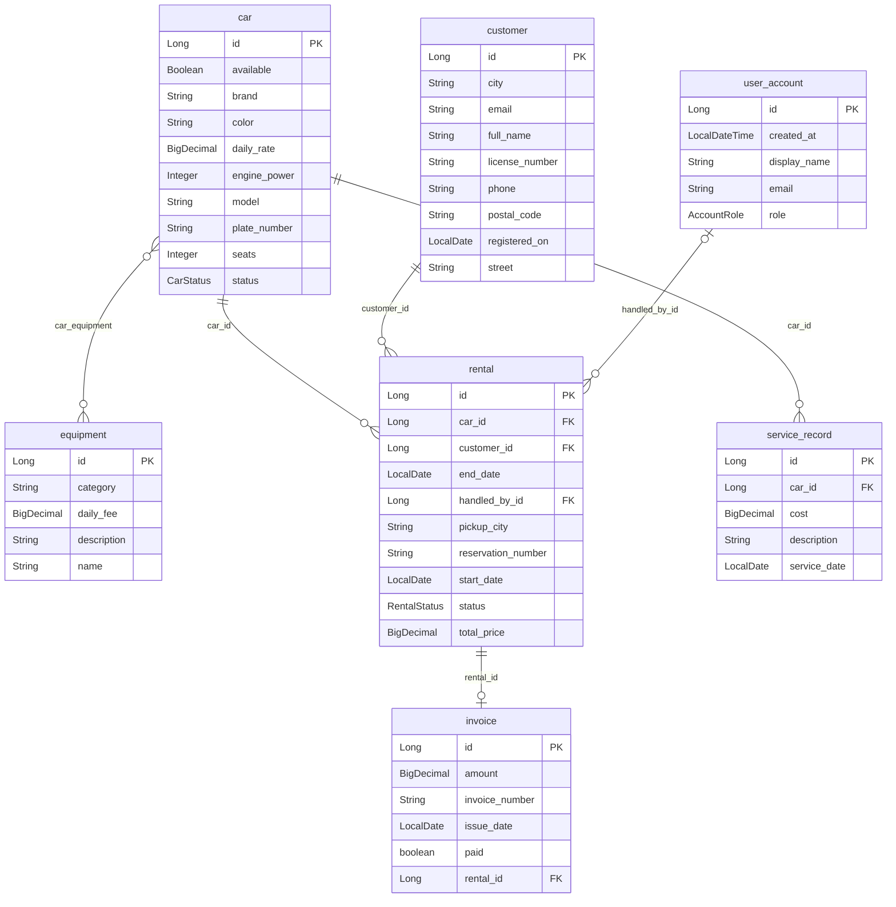

# Schemat bazy danych

Plik generują reguły projektu (panel Maven → Lifecycle → verify). Nie edytujcie go ręcznie.

Tabele: 8 (w tym tabele łączące @ManyToMany: car_equipment) · kolumny: 50 · relacje: 4 × @ManyToOne, 1 × @OneToMany, 1 × @OneToOne, 2 × @ManyToMany

| Tabela | Encja | Kolumny | Klucze obce |
|---|---|---|---|
| car | Car | 10 | — |
| customer | Customer | 9 | — |
| equipment | Equipment | 5 | — |
| invoice | Invoice | 6 | rental_id |
| rental | Rental | 10 | car_id, customer_id, handled_by_id |
| service_record | ServiceRecord | 5 | car_id |
| user_account | UserAccount | 5 | — |

